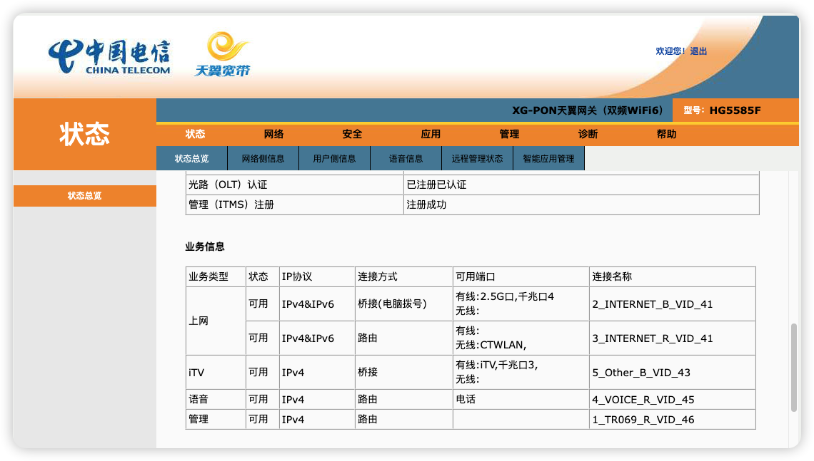
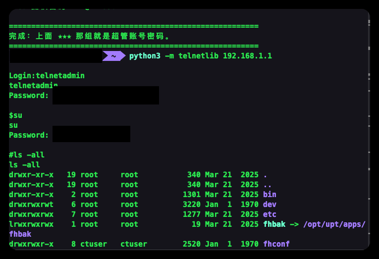

# 天翼网关超级管理员密码读取工具


[](https://github.com/gshtwy/tianyi-gateway-tool/actions/workflows/self-test.yml)


单文件、零依赖的 Python 工具：读取自家天翼网关（烽火 HG5585F）的超级管理员账号密码，并可选择开启或关闭 Telnet。





- 单一 `.py` 文件，下载即用
- 纯 Python 标准库 + 内置 AES，不需要 pip 安装任何东西
- Windows / macOS / Linux 同一份文件，Python 3.7 ~ 3.13
- 不写死 IP、不写死 MAC：IP 运行时输入，MAC 从光猫自动读取，读不到可手动输入机身贴纸 MAC


## 兼容范围


| 状态 | 型号 / 固件 |
| --- | --- |
| 已实测 | 烽火 HG5585F（电信版），硬件 V4.2.0 / 软件 V4.20.M5000 |
| 理论可试 | 同平台、同 fh_tool 接口的其它烽火天翼网关（未验证，欢迎在 Issue 反馈实测结果） |
| 不适用 | 华为、中兴等其它厂商代工的天翼网关（接口不同，本工具无效） |


## 快速开始


1. 在本仓库的 Releases 里下载 `get_superpwd.py`（或直接下载仓库里的同名文件）
2. 电脑连着光猫所在的网络，打开终端运行：
   - macOS / Linux：`python3 get_superpwd.py`
   - Windows：`py get_superpwd.py`
3. 按提示输入光猫 IP（直接回车默认 192.168.1.1），其余步骤全自动：局域网检查 → 读 MAC → 读设备信息 → 读超级管理员密码 → 选择 Telnet 操作（1 开启 / 2 关闭 / 3 不动，回车默认不动）


离线自检（不连接光猫，只验证本机 Python 环境）：


```
python3 get_superpwd.py --self-test
```


看到 `SELF-TEST OK` 说明本机环境没问题。


## Telnet 说明


- 开启后账号：`telnetadmin`
- 密码由脚本按本机 MAC 自动算出并打印：固定前缀 + MAC 后 6 位；`su` 提权密码同理。换一台光猫密码自动跟着变，不要照抄别人的。
- Telnet 登录连错 3 次会锁定约 300 秒，不要反复猜密码。
- Telnet 是明文协议，只在局域网内使用，不要映射到公网；不用时建议用本工具关闭。


## 原理


见 [docs/principle.md](docs/principle.md)。常见问题见 [docs/faq.md](docs/faq.md)。让插件不上报、不扫描的处置方案见 [docs/mitigation.md](docs/mitigation.md)。


## 实测附记：光猫里的 m01-b01-inner 采集插件自查记录

（本文亦单独存于 [m01-b01-inner.md](m01-b01-inner.md)）

起因很简单：看到有人讨论电信光猫里的 `m01-b01-inner` 插件，说它能从流量里抠设备标识、能远程执行命令、还能扫内网。说得挺吓人，但样本都是拆机或断网的机器，到底在正常服役的光猫上是什么样，没人给出实测。我家的光猫正好是同系列，我决定自己查一遍——全程只读，不改配置、不重启任何东西，查完不留痕。

**我的设备**：烽火 HG5585F（天翼网关 4.0，XG-PON，固件 V4.20.M5000），路由模式，光猫自己拨号，全家流量都从它走。

### 一、进程里有个不认识的「住户」

拿到 root shell 后先看进程。除了烽火自家的管理进程，机器里还跑着一整套插件系统，其中一条链是：`appmgr` 拉起容器里的 `b01odmv3`，`b01odmv3` 再拉起 `m01-b01-inner`。内核模块列表里：

```
# cat /proc/modules | grep m01
m01_b01 176128 0 - Live 0xffffffc009c04000 (O)
maxnetdpi 16384 2 m01_b01, Live (O)
```

一个 DPI（深度包检测）引擎挂在内核里，被这个插件引用着。进程的内存映射里还有一段 4 MB 的可写共享内存——内核把解析出来的东西经这块内存递给用户态的插件本体。我先确认了它和宿主在同一个网络命名空间，也就是说，我在宿主上用普通网络命令就能观察它。

### 二、先排除「被人植入」：文件是原装的

插件住在 `/files/`：`b01odmv3`、`m01-b01-inner`（1.5 MB）、`init.bin`、`m01-b01.ko`、`config`、`md5.txt`。我把四份文件逐个算了 MD5，和厂商自带的 `md5.txt` **逐项对上**。结论先行：这不是谁黑进来塞的东西，是出厂/运营商通道放进来的原装组件。这一点很重要，后面所有发现的性质都由此决定。

### 三、配置里明写着它要往哪儿连

`config` 是明文的，四条通道写得清清楚楚：

```
__svr_data  → b01-data-reported.189cube.com:7890   每 1800 秒
__oper_data → b01.189cube.com:7870（过滤器 rawpkt） 每 600 秒
__svr_oper  → b01.189cube.com:7870                 心跳 7200 秒
sigcollect  回写周期 14400；pktpolicy = get_kapiver；还有看门狗盯着进程本身
```

域名能解析、服务器活着（其中一台 ping 约 37 ms）。但配置只能证明「打算连」，不能证明「真在连」。

### 四、蹲守：它真的在往外发

我先手查了几次 netstat 和连接跟踪表，全是空的——连接只持续几秒，快照很容易扑空。于是我在光猫上挂了个每 2 秒扫一次的小记录器，让它自己蹲。当晚 20:39，它抓到了：

```
<本机WAN地址>:54986 → 58.209.223.235:7890  TIME_WAIT
```

58.209.223.235 就是配置里那个主数据服务器。TIME_WAIT 这个状态只有连接**完整建立、传完、正常关闭**之后才会出现，连不上、被拒绝的连接走不到这一步。所以这件事在我这里没有模糊空间：**这台正常服役的光猫，当晚实打实地向电信的数据服务器完成了一次上报。**节奏与配置的 1800 秒周期吻合。

### 五、把内存里的源码读出来：它到底由哪些模块组成

插件的逻辑是一份加密的 Lua，打包在 `init.bin` 里，运行时解密到临时文件、加载完就删——磁盘上找不到原文。我按取证的常规做法，只读导出了进程的两段可写内存（主堆 9.4 MB ＋一段 14.6 MB，合计约 24 MB），在里面搜模块定义。结果有个超出我预期的发现：这台机器上的采集模块大多带 **`hot_` 前缀**，也就是**经热补丁通道后下发进来的，不是出厂写死的**。名单如下：

内置的两个：`shell`，自我介绍原文 "run shell cmd and return result"——在光猫上以 root 执行命令并回传结果；`__http_rule`，HTTP 规则配置。

热补丁组：`hot_xid`（从 HTTP 收集用户身份标识）、`hot_capapp`（从抓包载荷和 HTTPS 里识别应用并发服务器）、`hot_qmetric`（质量数据聚合）、`hot_sigcollect`（采集系统与 HTTP 信息、供热补丁决策）、`hot_http_filter`（按关键词从 URL、Cookie、Referer、User-Agent 里拾取键值）、`hot_https_filter`（按域名关键词拾取 HTTPS 连接）、`__hot_app`（从内核拿应用清单发服务器，联动内核转储与 `pcap_dump` 原始抓包）。

### 六、xid 细看：这是今晚最让我不舒服的一段

`hot_xid` 的定义我完整读了。它在 HTTP 的 URL 参数、Referer 和 Cookie 里翻找下面这些键，并用专门的格式校验式确认抠到的值是真的：

```
keyexpr: androidid, bdid, caid, device_type, mac, idfa, idfv,
         imei, imsi, latitude, longtitude, meid, model, oaid,
         phone, stbType
valexpr: phone = "((^|[^a-zA-Z0-9])1[3-9][0-9]{9}([^a-zA-Z0-9]|$))"
         imsi  = "(^\"?460[0-9]{12}\"?$)"
         imei  = "(^\"?(86|35)[0-9]{13,15}\"?$)"
```

手机号校验式是大陆号段的（1[3-9] 开头 11 位），IMSI 钉死 460（中国 MCC），IMEI 认 86/35 开头——**这套规则是专为抠中国用户标识写的**。它的上报方式写的是 `upload_mode = "svrdata"`、周期 1800 秒——正是我第四节蹲到的那条通道。机制边界我也说清，免得传歪：它抠的是**明文 HTTP** 里出现的这些字段，不读 SIM 卡、不解密 HTTPS；哪个 App 用明文 HTTP 传了手机号或 IMEI，它就顺手抄走一份。清单末尾的 `stbType`（机顶盒）说明它连 IPTV 终端一并盘点。

### 七、扫描器也在，只是我没去碰它

内存里有 `@./service/pscan.lua`、`pscan_timer`，和一句设置说明：「set pscan period and argv, period = 0 means close model, argv can be changed by yourself」——一个可由服务端设置周期和扫描参数的内网扫描模块，period 为 0 即关闭。它当前是不是 0，我没有进一步查，更没有调用它——只读原则到此为止。另外 rawpkt 原始抓包有整套共享内存通道，常量里包括一个 `MEMSHR_RAWPKT_CAP_ALL`，即全量抓取开关；`hredirect`（HTTP 重定向）字符串亦在。

### 八、我的结论，分两栏放

能确定的：这套插件是运营商原装下发的、活的、可热更新的采集系统；在我这台服役机上，主数据通道真实在发；它的标识清单（手机号、IMEI、IMSI、OAID、IDFA、CAID、MAC、机型、粗略经纬度键）是源码级事实；远程命令执行、原始抓包、内网扫描这些能力件都在箱子里，是否启用由服务端说了算。

不能确定的：它在我家网里**实际抓到过什么**。上报内容加密，源码里的计数是模板初值，我无法、也不打算去解密它发出的包。所以我只主张到「它被配置成抓这些、且通道在往外发」为止。进程还有几段内存我没有导出，边角模块不排除遗漏。

最后说句题外话：这台机器就摆在我家客厅，电费我交、宽带费我交，里面跑着一个我从没被告知、更没被征得同意的采集系统，每半小时向外发一次东西。这篇自查我全程只读，导出的文件已经删干净——我只是想弄清楚自己家里的设备在干什么，这应该是每个用户都有的权利。


## 让 m01-b01-inner 不上报、不扫描的处置方案

（本节亦单独存于 [docs/mitigation.md](docs/mitigation.md)）

> 结论先行：**推荐方案 A（光猫改桥接、自有路由器拨号）**；临时过渡可用方案 B（iptables 阻断）；方案 C（杀进程/改配置/删文件）是打地鼠，不推荐。任何方案做完都要按文末的验收方法实测，不测不算数。

适用样本：烽火 HG5585F（固件 V4.20.M5000）实测。其它带同一插件（SAF 插件系统 + `m01-b01-inner`）的机型原理相同，细节请先自查再套用。

### 先认清对手：为什么没有「关掉它」的开关

- 插件进程有看门狗（配置里的 `__watch`）和插件管理器（appmgr）双重拉起，杀掉会复活；
- 它的逻辑包在 `init.bin` 里，启动时解密加载，改磁盘文件、改运行时配置都会在重启或热补丁后被覆盖；
- 采集模块多为 `hot_` 热补丁形态，服务端可以随时下发新版、改服务器地址、开新模块；
- 所以思路不是「删掉它」，而是**断它的路**：让它连不上报服务器，能力件就无从启用（pscan 这类模块靠服务端下发周期与参数才能开工，通道断了就是一块 inert 代码）。

它要连的地址（2026-11-22 实测解析，IP 可能随 DNS 变化，动手前请重新解析确认）：

| 通道 | 地址 | 用途 |
| --- | --- | --- |
| 主数据上报 | `b01-data-reported.189cube.com:7890`（58.209.223.235） | xid、应用清单等走这条，周期 1800 秒 |
| 运维通道 | `b01.189cube.com:7870`（101.89.160.191） | 数据 600 秒、心跳 7200 秒 |

### 方案 A（推荐）：桥接模式 + 自有路由器拨号

**原理**：路由模式下光猫自己拨号，插件借光猫的公网出口直达上报服务器。改桥接后，光猫不再拨号、失去自己的公网路由，互联网出口转移到你的路由器；插件所在系统只剩运营商管理面那条受限通道，到不了公网服务器。原帖两台桥接样本「连不上」正是这个道理。附带好处：消掉一层 NAT。

**动手前记录（务必先截图备份）**：

- 宽带账号、密码（路由器拨号要用；不知道就打 10000 或问装维，这是改桥接的标准需求）；
- 互联网连接的 VLAN ID（本机实测为 41，各地以本机现值为准）；
- IPTV、固话的连接方式（哪条连接、绑哪个 LAN 口）。

**步骤**：

1. 用超级管理员登录光猫后台 → 宽带/网络设置 → 找到**互联网连接**（不要动 TR-069 管理连接，不要恢复出厂）；
2. 该连接的模式由「路由」改为「桥接」，绑定到接自有路由器的那个 LAN 口，保存；
3. 自有路由器 WAN 口新建 PPPoE 拨号，填宽带账号密码（MTU 1492），确认路由器拿到公网地址；
4. 逐项验证：上网、IPTV、固话（如有）全部正常；
5. 按文末验收方法蹲守复查。

**回滚**：互联网连接改回路由模式、光猫恢复拨号，路由器删掉 PPPoE 即可，全程可逆。

**诚实标注**：桥接后插件进程和模块仍然在机器里，只是（按通道原理与既有样本）发不出去。是否彻底沉默必须实测，不同地区、不同固件批次可能有差异——验收不过，就叠加方案 B 的思路在**自有路由器**一侧再观察，或保留记录另行分析。

### 方案 B（临时）：在光猫上用 iptables 阻断上报地址

插件与宿主在同一网络命名空间，宿主的 OUTPUT 链管得着它。root shell 里执行（先 `iptables -L OUTPUT -n` 确认 iptables 可用）：

```
iptables -I OUTPUT -d 58.209.223.235 -p tcp --dport 7890 -j DROP
iptables -I OUTPUT -d 101.89.160.191 -p tcp --dport 7870 -j DROP
```

**硬伤，先说清**：

- 光猫重启即失效，本机没有现成的规则持久化位置，只能当临时验证手段；
- 服务器 IP 可能轮换、端点可能经热补丁更新，封 IP 是猫鼠游戏；
- 阻断后插件可能频繁重试连接，属正常现象，不影响上网业务（它走的是独立通道）。

适合：改桥接前的过渡期、或用来验证「断了这两个地址它是否就安静了」。

### 方案 C（不推荐）：杀进程 / 改 config / 删文件

逐条说明为什么别费这个劲：看门狗和 appmgr 会把进程拉回来；`config` 与 Lua 都源自 `init.bin`，重启重新解出；热补丁通道随时把新版推回来；删文件还可能触发插件系统异常，连带影响光猫其它功能。投入产出比最差，且把服役机置于不稳定状态。

### 方案 D（日常并行）：减少明文 HTTP 暴露

xid 只能抠**明文 HTTP** 里的字段，抠不到 HTTPS 内容。无论是否改桥接，都建议：浏览器开启「始终使用安全连接 / HTTPS-Only」、及时更新家里 IoT 设备的固件、关掉用不到的明文管理口。这条挡不住设备盘点类上报，但能显著减少 xid 的实际收获。

### 验收方法（任何方案做完都要跑）

在光猫 root shell 里挂一个每 2 秒记录一次的蹲守器，覆盖至少一个完整上报周期（1800 秒，建议 35 分钟以上）：

```
(while true; do R=$(netstat -an | grep -E '7890|7870'); [ -n "$R" ] && { date; echo "$R"; }; sleep 2; done >> /tmp/b01.log 2>&1 &)
```

到期后 `cat /tmp/b01.log`：

- **空白** = 观察窗内没有任何到上报服务器的连接，方案生效（注意：这证明的是「这段时间没连」，配合周期已覆盖完整 1800 秒才有说服力）；
- **仍有 TIME_WAIT 记录** = 通道还通，方案未生效，回到对应方案排查；
- 辅助复查：`cat /proc/net/nf_conntrack | grep -E '7890|7870'` 应为空。

### 风险与边界

- 改桥接是家庭网络结构调整，业务中断窗口以分钟计，请挑空闲时段操作，并先备好回滚路径；
- 不要动 TR-069 管理连接：那是运营商下发业务配置的通道，动了可能导致业务异常、报障时排查困难；
- 运营商理论上可经远程管理恢复其配置，本文方案不保证永久性，验收结论以你本机实测为准；
- 本文只讨论设备所有者对自有家庭网络与设备的处置，不涉及任何绕过计费、认证或他人网络的内容；操作风险自担。


## 免责声明


- 本工具仅用于管理你本人拥有或被授权管理的设备，使用风险自担。
- 读取到的超级管理员密码属于敏感信息，请勿在 Issue、截图或聊天中公开发送；反馈问题时 MAC 只发前 6 位、密码一律不要发、截图先打码。
- 本工具在本地运行，只与你输入的光猫地址通信，不向任何其它地址发送数据。


## License


MIT

